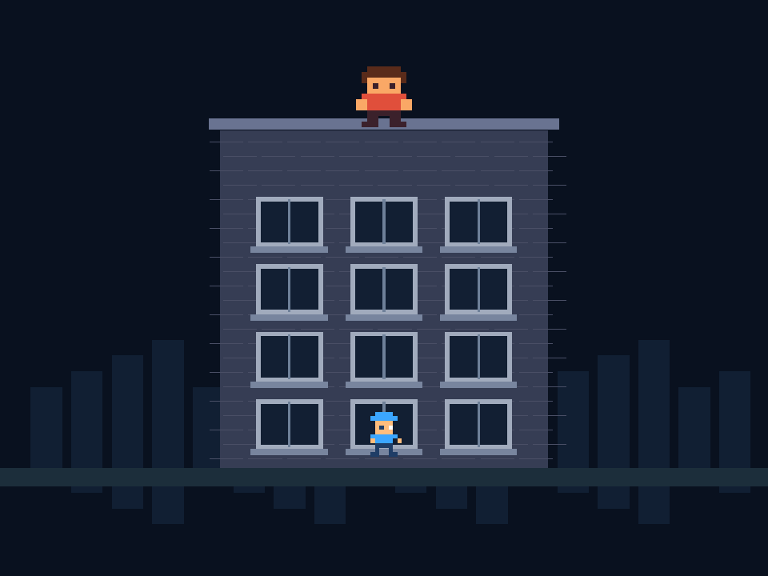

# Fix-It Felix Jr. — Unity 2D

This is a 2D arcade fan game where you race the clock to repair windows and dodge falling bricks. Play the Windows build or open the Unity project to see how movement, hazards, and timed levels work.

A Unity 6 / C# arcade fan project with original procedural pixel sprites and synthesized sounds. This is the current game implementation. The earlier Scratch edition is preserved under [Legacy/Scratch](Legacy/Scratch/README.md).



The preview is an actual Unity camera render. The in-game HUD and menus are drawn separately.

## Open and play

1. In Unity Hub choose **Add project from disk** and select `UnityGame` (not the repository root).
2. Use Unity **6000.4.7f1**, the version recorded in `UnityGame/ProjectSettings/ProjectVersion.txt`.
3. Open `Assets/Scenes/Arcade.unity` and press **Play**.
4. Press **Enter** or click **Start Shift**. Move with arrow keys or WASD; press **Space** to repair.

If the scene has not yet been generated, choose the editor menu **Felix / Prepare scene and verify**. The Windows build can run without the Unity editor; build it using the menu or command below. No paid assets, subscriptions or API keys are used by this game.

## Rules and controls

- Three columns and four floors; movement stays inside the building.
- Repair a broken window for 100 points. Intact windows award no repeat points.
- Ralph drops bricks that break windows as they fall. A hit costs one of three lives; 1.1 seconds of protection prevents immediate repeated damage.
- Repair all 12 windows to advance a level, add 20 seconds and increase attack speed.
- The countdown starts at 60 seconds. Zero lives or time ends the run.
- **Esc:** pause/resume. **R:** restart. **M:** mute/unmute. **Enter:** start or restart after game over.

The fixed four-floor layout and simplified attacks are an original fan interpretation, not a recreation of every commercial-game mechanic. Desktop keyboard controls are supported; mobile/touch and WebGL builds are not included.

## Source and editing

- `UnityGame/Assets/Scripts/GameState.cs`: engine-independent scoring, movement, damage and level rules.
- `UnityGame/Assets/Scripts/FelixGame.cs`: Unity SpriteRenderers, procedural artwork/audio, input, falling bricks, HUD and pause/start screens.
- `UnityGame/Assets/Editor/FelixBuild.cs`: reproducible scene generation, rule verification and Windows build.
- `UnityGame/Assets/Scenes/Arcade.unity`: saved start scene.
- `docs/unity-verification.json`: actual Unity rule-check result.
- `Legacy/Scratch/`: preserved source, assets, guides and checks for the former edition; its previous test results do not validate Unity.

See [the Unity editing guide](docs/unity-guide.md).

## Build and verify

From the repository root in PowerShell (adjust the editor path if needed):

```powershell
& 'C:\Program Files\Unity\Hub\Editor\6000.4.7f1\Editor\Unity.exe' -batchmode -nographics -quit -projectPath "$PWD\UnityGame" -executeMethod FelixBuild.BuildWindows -logFile "$PWD\unity-build.log"
```

The build command checks game rules, saves the scene and produces `Builds/Windows/Felix2D.exe`. Build output and Unity caches are ignored by Git. Source and the generated scene are sufficient to rebuild. Run rule checks alone with `-executeMethod FelixBuild.Verify`.

## Artwork and names

The pixel characters, building and sounds are generated by this project's code. Fix-It Felix Jr., Felix, Ralph and Wreck-It Ralph are associated with Disney. This is an unofficial fan/learning project, not affiliated with or endorsed by Disney or Unity.
